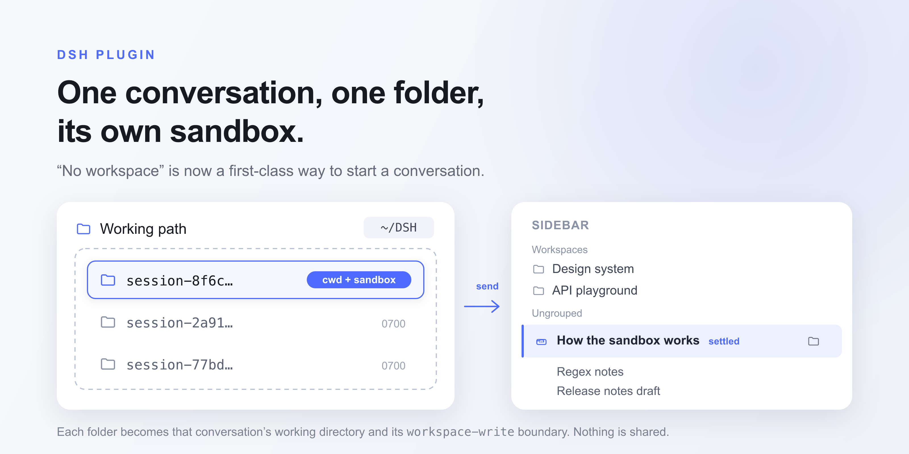
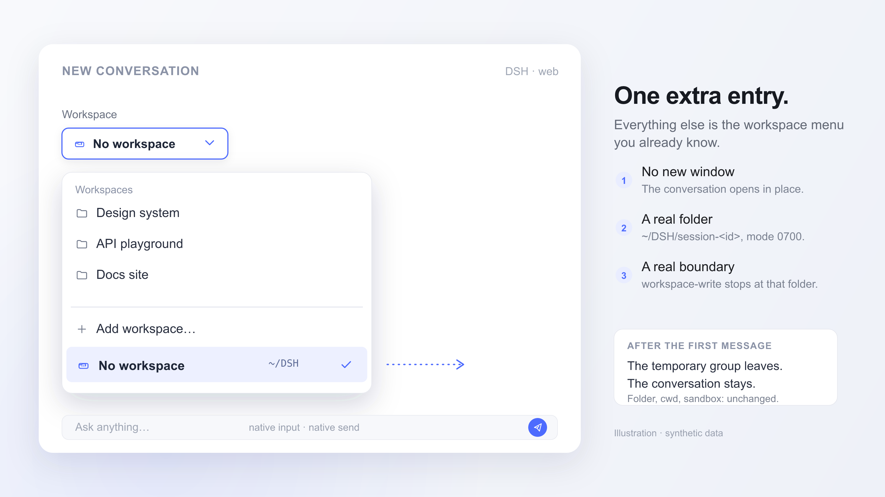
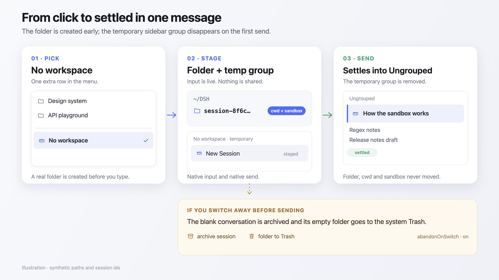
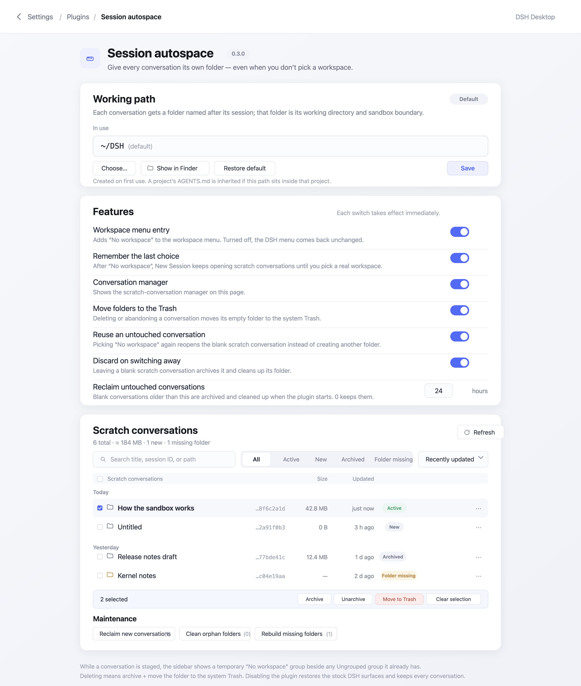
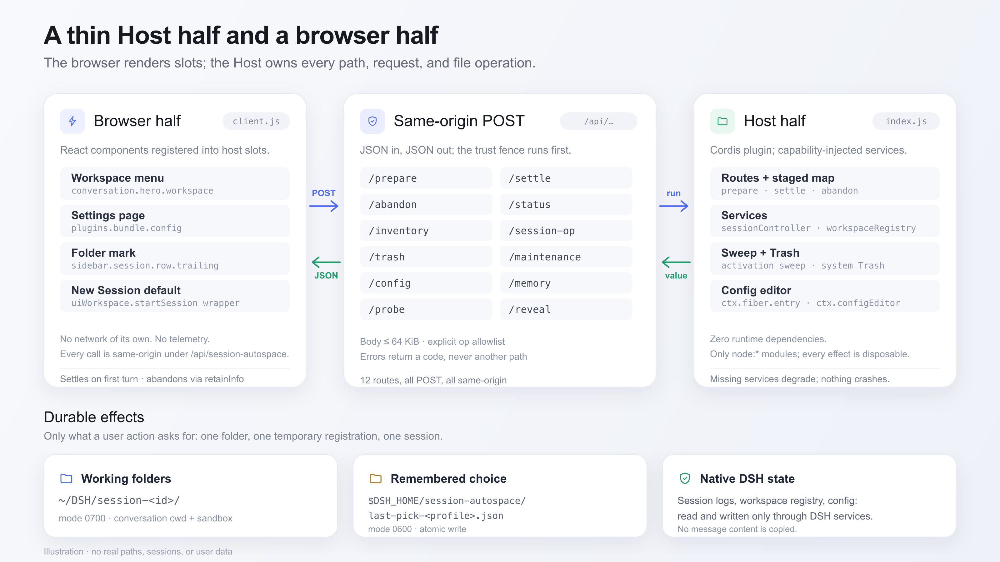

<div align="center">
  
</div>

# Session Autospace

> Start a conversation without picking a workspace.

[中文](README.md) · [English](README.en.md)

[](LICENSE)
[](package.json)
[](package.json)
[](test)

**Session Autospace** is a DSH bundle plugin. It adds **No workspace** to the workspace menu on the new-conversation screen. Pick it and the plugin creates `<working path>/session-<uuid>/`, then uses that folder as the conversation's `cwd` and `workspace-write` sandbox boundary. Input, sending, titles, and archiving stay on DSH's native paths. After the first message the temporary workspace registration is removed and the conversation settles into the sidebar's **Ungrouped** section.

It adds no model tools, proxies no messages, does not modify DSH's existing configuration or session logs (the settings page writes only this plugin's own row), and does not require the working path to be a project.

---

## Why

DSH's workspace model is project-centric: a workspace maps to a real directory, a conversation starts inside it, and sandbox writes are limited to that directory. That is a good fit for project work, but awkward for conversations like:

> "Look at this log." "Explain this regex." "Write a one-off script." "Jot this down; I'll archive it later."

Those conversations do not belong to a project. The old choices were:

1. Put them in the nearest workspace, where scratch files, scripts, and experiments pollute the project.
2. Create a temporary workspace, where several conversations share one `cwd` and can overwrite each other's files.

Session Autospace adds a third choice: **one conversation, one folder, one sandbox boundary**. Sandbox write scopes no longer overlap, and cleanup is a folder operation.

## What you get

- **One extra workspace-menu entry.** The rest of the menu, including **Add workspace…** and keyboard navigation, is unchanged. Turn the switch off and DSH's stock menu returns.
- **A real session and a real folder.** The plugin mints `session-<uuid>`, creates a directory with that name (`0700`), registers a temporary workspace, and creates a blank session inside it. The session's immutable `cwd` is that directory.
- **Native input and native send.** The input bar is not replaced, messages are not intercepted, and conversation content is not rewritten. On the first `turn/start` the plugin only removes the temporary workspace registration.
- **Settles into Ungrouped.** The temporary group disappears; the conversation becomes a normal one. Its folder, `cwd`, and sandbox boundary never move. Even with **Manual** ordering on, the settled conversation is led to the top of **Ungrouped** (DSH's own pin write leads the saved order, then the pin is released), so it never sinks below older conversations.
- **Remembers the last choice.** After **No workspace**, New Session keeps opening scratch conversations from the sidebar, title bar, or `⌘N` until you pick a real workspace. A conversation that already belongs to a real workspace still keeps New Session there.
- **One settings page.** Working path, nine settings, and the scratch-conversation manager live under **Settings → Plugins → Session autospace**.
- **Conversation management.** Search, filter, sort, open, rename, pin, archive, reveal, copy path, move to Trash, bulk actions, and maintenance.
- **Safe deletion.** DSH has no permanent delete: deleting means archiving the conversation and moving its folder to the system Trash. A running conversation is refused first; the UI asks before stopping and archiving.
- **Bilingual, keyboard-friendly, accessible.** Follows DSH's locale (`zh` / `en`). Menus, row menus, and dialogs have keyboard paths and focus restoration.

## Screens

> The images below are illustrations drawn at the proportions of the real UI. They use synthetic paths and titles and contain no real user data. The SVG sources live in `docs/images/`.

### The new-conversation screen: one extra entry



The menu is still DSH's workspace menu: existing workspaces, a separator, then **Add workspace…** and **No workspace**. The entry shows where the new folder will be created (default `~/DSH`).

### Three states: pick, stage, settle



- **Pick**: create the `session-<uuid>` folder, a temporary workspace, and a blank conversation.
- **Stage**: the input bar is live and a temporary **No workspace** group appears at the top of the sidebar. If an **Ungrouped** group already exists, both are visible.
- **Settle**: the first message is sent; the temporary group disappears and the conversation moves into **Ungrouped** with a folder mark on its row.
- **Abandon**: switch away before sending; the blank conversation is archived and its empty folder goes to the system Trash (unless `abandonOnSwitch` is off).

### Settings: path, switches, manager

[](docs/images/settings.png)

<sub>Click the image for the full-size render.</sub>

The working-path card accepts an absolute path and offers Choose, Show in Finder, and Restore default. Each feature switch takes effect immediately. The manager joins conversation rows with folder facts and maintenance actions.

## Install

### Requirements

- DSH `>=0.2.1-rc.2 <1.0.0` (see `engines.dsh` in `package.json`).
- A working `dsh` CLI.
- Network access to GitHub and a `git` binary on your machine (pnpm needs it to resolve git-hosted dependencies).
- macOS, Linux, or Windows. Folder removal uses the system Trash; when it is unavailable the UI points you to **Show in Finder** instead of degrading to a hard delete.

### From GitHub (recommended)

```sh
dsh plugin --profile <profile> add github:DaozeTang/dsh-session-autospace
```

`dsh plugin add` forwards its arguments to pnpm inside the profile directory, so pnpm pulls the repository straight from GitHub. **No `git clone`, no local checkout, and no build step are required.** `<profile>` is the profile to install into, for example `desktop`. List your profiles first if unsure:

```sh
ls "${DSH_HOME:-$HOME/.dsh}/profiles"
```

Restart DSH or reopen the window. To confirm the layer is in the composition:

```sh
dsh --profile <profile> --dump-config | grep -n "session-autospace"
```

You should see the `session-autospace` layer or row. The plugin ships plain JavaScript, so installing from GitHub needs no compilation.

To choose a branch, tag, or commit, append the reference to the repository:

```sh
dsh plugin --profile <profile> add github:DaozeTang/dsh-session-autospace#main
```

Replace `main` with a tag or commit hash to pin a specific version.

### From a local checkout (development)

```sh
git clone https://github.com/DaozeTang/dsh-session-autospace.git
dsh plugin --profile <profile> add ./dsh-session-autospace
```

Useful when iterating on the source; for a normal install use the GitHub command above.

### From a tarball

```sh
pnpm pack
dsh plugin --profile <profile> add ./dsh-session-autospace-0.2.1.tgz
```

### Upgrade and remove

```sh
# upgrade: remove, then add again from GitHub
dsh plugin --profile <profile> remove dsh-session-autospace
dsh plugin --profile <profile> add github:DaozeTang/dsh-session-autospace
```

An install with a `#` reference follows that branch, tag, or commit; change the reference to move to another version.

Removing the plugin does not delete existing conversations or folders; they remain normal DSH conversations. See [Uninstall](#uninstall) for cleanup.

## Quick start

1. Start a new conversation and open the workspace menu.
2. Pick **No workspace**. The page becomes ready to type and the chip reads **No workspace**.
3. Send the first message.
4. The temporary sidebar group disappears; the conversation appears under **Ungrouped** with a folder icon.
5. Press New Session again: you get another scratch conversation. Open a real-workspace conversation and New Session returns to that workspace.

The resulting layout:

```text
~/DSH/
  session-8f6c2a1d-.../      # this conversation's cwd and sandbox boundary
  session-2a91f0b3-.../
  session-77bde41c-.../
```

## How it works

### Three states

| State | Conversation | Workspace registration | Sidebar | Input | Sandbox boundary |
| --- | --- | --- | --- | --- | --- |
| Idle | none | none | unchanged | — | — |
| Staged | created, blank, no messages | one temporary registration titled "No workspace" | temporary group at the top, holding New Session | native, ready | `<working path>/session-<uuid>` |
| Settled | same conversation, first turn done | removed | ordinary row under Ungrouped | native | same folder, unchanged |
| Abandoned | blank conversation archived | removed | group and New Session gone | — | empty folder to Trash (can be disabled) |

State machine:

```text
idle --prepare--> preparing --ok--> staged
preparing --fail--> idle (error stays in the menu, retry available)
staged --turn/start--> settling --> settled (remove the temporary registration)
staged --main view taken by another conversation, still blank--> abandoning --> abandoned
staged --pick a real workspace instead--> abandoning
staged --past the reclaim threshold--> reclaiming --> reclaimed
```

### Why the folder exists before you send

A blank DSH conversation that accepts input must belong to a real workspace, and a workspace path must already exist. The conversation's `cwd` is immutable after creation. So the plugin creates the folder and the session when you click **No workspace**, not when you send. The cost is a temporary sidebar group during staging; it disappears on send or abandon.

### Three settle channels

1. **Host event**: `session/event` catches the conversation's first `turn/start` and removes the temporary workspace registration.
2. **Client observation**: the client watches the blank flag with `useSessions` and calls the idempotent `/settle` route when it flips.
3. **Activation sweep**: on plugin start the staged table is rebuilt and leftovers from a crash, a closed window, or long disuse are handled; blank conversations older than `autoReclaimHours` are reclaimed.

Host cleanup retries with backoff (200 / 800 / 2000 ms, up to three attempts), then leaves the entry for the next activation sweep.

### Internals



The browser half only renders slots: the workspace menu, the settings page, the conversation-row badge, and the `uiWorkspace.startSession` wrapper. It never touches the filesystem and makes no remote requests.

The Host half is a single-file Cordis plugin organised as `config`, `paths`, `scratch`, `settle`, `trash`, `inventory`, `routes`, `sweep`, and `log`. It has zero runtime dependencies and uses only `node:*`. Every registration is held by `ctx.effect` / `ctx.inject`; a missing service disables a capability instead of crashing.

### How New Session remembers the choice

DSH has no slot for the new-session entry: the sidebar button, the title-bar button, and the `session.new` command all end up in `uiWorkspace.startSession`. The client wraps that method and only takes over calls with no explicit workspace and no initial content:

- Explicit real workspace → hand back to DSH's "current workspace" logic.
- Explicit temporary workspace → go through `/prepare`, so a second conversation does not land in the same folder.
- Calls with `prompt` / `clearPreviousDraft` → pass through untouched.
- Current main-view conversation belongs to a real workspace → leave it to DSH.
- No workspace and the last choice is `scratch` → run the same preparation flow as the menu.

Any error falls back to the original method; the wrapper is restored when the service is revoked or the plugin reloads. The choice is stored in `$DSH_HOME/session-autospace/last-pick-<profile>.json`, not in profile configuration, and does not trigger a plugin restart.

## Configuration

Every field is on **Settings → Plugins → Session autospace**. Defaults also live in `cordis.patch.yml`.

| Key | UI | Default | Notes / when off |
| --- | --- | --- | --- |
| `workspaceRoot` | Working path | `""` | Empty means `~/DSH`; saved paths are checked for absolute form, NUL, and writability |
| `pickerEntry` | Workspace menu entry | `true` | Off unregisters the menu slot; DSH's built-in menu returns |
| `rememberPick` | Remember the last choice | `true` | Off returns New Session to DSH's "current workspace, else most recent" |
| `management` | Conversation manager | `true` | Off hides the whole manager card |
| `trashOnDelete` | Move folders to the Trash | `true` | Off makes delete archive-only; the folder stays |
| `rowBadge` | Folder mark on conversation rows | `true` | Off unregisters the row-trailing slot |
| `reuseBlank` | Reuse an untouched conversation | `true` | Off creates a new folder on every click |
| `abandonOnSwitch` | Discard on switching away | `true` | Off removes the registration only; session and folder stay |
| `autoReclaimHours` | Reclaim untouched conversations | `24` | `0` disables auto-reclaim; range 0–8760 hours |

If the working path sits inside a project tree with a `.git` entry, the project's `AGENTS.md` applies to every conversation created there; the settings page warns about it on the path card.

Default patch:

```yaml
- insert:
    - id: session-autospace
      name: dsh-session-autospace
      config:
        workspaceRoot: ''
        pickerEntry: true
        rememberPick: true
        management: true
        trashOnDelete: true
        rowBadge: true
        reuseBlank: true
        abandonOnSwitch: true
        autoReclaimHours: 24
```

Configuration writes go through the Host's `configEditor`. Saving rebuilds the plugin once through the Loader lifecycle; the client re-fetches state after a write. There is no schema and no dependency on `@deepseek-ai/schemastery`.

## Manager

The third card joins the client session list with the Host folder inventory by session id:

| Action | Behaviour |
| --- | --- |
| Open conversation | Navigate to that conversation |
| Rename | Title only; the folder is untouched |
| Pin / Unpin | Uses DSH's pin service |
| Archive / Unarchive | Archive is restorable; a running conversation asks before stopping |
| Show in Finder | Reveals the folder through the Host |
| Copy path | Copies the absolute folder path |
| Move to Trash | Archives first, then moves the folder to the system Trash; never hard-deletes |
| Bulk actions | Archive, unarchive, move to Trash; up to 100 rows at a time |
| Reclaim new conversations | Archive blank conversations past the threshold and clean empty folders |
| Clean orphan folders | Directories named `session-<uuid>` that no conversation claims |
| Rebuild missing folders | Recreate a folder whose conversation still exists |

Search covers title, session id, and path. Filters: All / Active / New / Archived / Folder missing. Sort: recently updated, title, size. Destructive actions ask first and say that the archive is restorable and the folder goes to the Trash.

## Data and privacy

### What the plugin writes

```text
<working path>/
  session-<uuid>/                 # conversation cwd and sandbox boundary; mode 0700 at creation
    ...                           # DSH tools read and write here

$DSH_HOME/session-autospace/
  last-pick-<profile>.json        # the last new-conversation choice; mode 0600, atomic write
```

- The directory name is exactly the session id, matching `^session-[0-9a-f]{8}-[0-9a-f]{4}-[0-9a-f]{4}-[0-9a-f]{4}-[0-9a-f]{12}$`.
- Session logs are not stored in that folder; DSH keeps them under its own `$DSH_HOME/sessions/...`. The plugin does not read message content.
- The memory file stores only `{version, kind, at}`: no title, no path, no conversation content.
- Directory mode `0700` and file mode `0600` are best effort; a permission failure does not block the main flow.

### Local first

- The plugin makes **no remote requests**: no telemetry, analytics, or crash reporting.
- No remote fonts, remote icons, or CDN dependencies in the plugin UI; it uses Host design tokens and local assets.
- The only browser traffic is same-origin `POST /api/session-autospace/*`.
- It adds no model tools and does not read or forward messages; the model sees exactly what a normal DSH conversation sees.

### Repository privacy conventions

- Example paths use `~/DSH` or `/Users/example`; no real user name is included.
- README images are rendered from `docs/images/*.svg` using synthetic titles, paths, and session ids.
- The render fixture (`test/render-check.mjs`) also uses anonymized paths and fixed fake ids.
- Before committing a screenshot, confirm it contains no real conversation title, workspace path, session id, terminal history, or notification content.

### Host-side validation

- Working path: absolute, no NUL, `mkdir -p`, then a stable `realpath`.
- Target folder: under `realpath(root)`, basename equals the session id, `lstat` says directory, symlinks refused.
- Session: must exist, `header.cwd` must equal the target folder's `realpath`; deletion refuses a running conversation.
- Requests: `POST` JSON, body ≤ 64 KiB, same-origin admission fence first; operations go through an allowlist, titles ≤ 200 characters, bulk ≤ 100 rows.
- Errors carry a code and a relative message, never another path.
- When the Trash is unavailable the plugin returns an explicit error and the UI points to Show in Finder; it never falls back to a hard delete.

### Reclaim rules

Auto-reclaim moves a folder to the Trash only when the folder is empty **and** its conversation is still blank. A folder with any content is archived only; deleting it is an explicit user action. This is what keeps the plugin from silently discarding files.

## HTTP contract

The browser half and the Host half talk over same-origin POST. Every route returns `{ ok: true, value }` or `{ ok: false, code, message }`.

<details>
<summary>Show the 12 routes (contributor reference)</summary>

| Route | Request | Success value |
| --- | --- | --- |
| `/status` | – | `{root, config, caps, staged, lastPick, version, ...}` |
| `/config` | `{patch}` | `{config}` |
| `/memory` | `{kind: 'scratch' or 'workspace'}` | `{kind, at}` |
| `/prepare` | `{requestId, locale}` | `{sessionId, workspaceId, path, reused}` |
| `/settle` | `{sessionId}` | `{settled, noop?}` |
| `/abandon` | `{sessionId, trash?}` | `{abandoned, trashed?, trashError?, settled?}` |
| `/inventory` | `{fresh?}` | `{root, folders, orphans}` |
| `/session-op` | `{sessionId, op, title?}` | `{ok}` |
| `/probe` | `{path}` | `{path, exists, writable, projectRoot}` |
| `/trash` | `{sessionId}` | `{archived, trashed, kept?, method?, trashError?, path?}` |
| `/reveal` | `{sessionId? or path?}` | `{revealed}` |
| `/maintenance` | `{op, ids?}` | `{changed, skipped}` |

Common codes: `ROOT_INVALID`, `ROOT_UNWRITABLE`, `SESSION_CONFLICT`, `WORKSPACE_CREATE_FAILED`, `NOT_SCRATCH`, `SETTLE_FAILED`, `ARCHIVE_FAILED`, `SESSION_RUNNING`, `FOLDER_MISSING`, `OUT_OF_ROOT`, `SYMLINK_REJECTED`, `TRASH_UNAVAILABLE`, `CONFIG_INVALID`, `CONFIG_WRITE_FAILED`, `BODY_TOO_LARGE`.

</details>

## Compatibility and degradation

There is no exact-version gate and no `@deepseek-ai/*` entry in `peerDependencies`. Features are capability-probed at runtime; a missing capability disables a surface instead of crashing.

| Missing capability | Behaviour |
| --- | --- |
| `webServer` or `connection` | Routes are not registered; the menu entry is disabled with a reason |
| `configEditor` | Settings page is read-only; switches are disabled with a reason |
| System Trash unavailable | Delete is disabled; archive remains; UI points to Show in Finder |
| `session/event` | Client blank observation and the activation sweep still settle |
| `retainInfo` | "Discard on switching away" is off; the activation sweep handles cleanup |
| `uiWorkspace` or a changed `startSession` shape | No wrapper is installed; New Session keeps DSH's behaviour; menu, settings, and badge still work |
| Memory file unreadable / unwritable | Unreadable means no memory; a failed write is logged, and the choice still applies for this page |
| Host slot contract changes | Nothing renders and one log line is written; the built-in menu is unaffected |

## Known limitations

- **A temporary sidebar group during staging.** DSH's sidebar has no "pinned but ungrouped" slot, and a blank conversation that accepts input must belong to a real workspace. The group disappears on send or when you switch away.
- **The folder is created on click, not on send.** A blank session must belong to a real workspace; a workspace path must exist; the session `cwd` cannot change after creation.
- **Delete only has a combined meaning.** DSH has no permanent-delete API, so delete = archive + move the folder to the system Trash.
- **The replaced menu depends on a Host contract.** If the owner props of `conversation.hero.workspace` change, the plugin degrades to rendering nothing and logging, instead of crashing.
- **The remembered choice is per profile.** It is not synced across machines; when `DSH_HOME` is unset the plugin falls back to `~/.dsh`.
- **Remembering depends on `uiWorkspace.startSession` remaining an ordinary instance method.** If it disappears, is renamed, or the object becomes non-extensible, the plugin falls back to DSH's original behaviour; the menu and settings page are unaffected.

## Development

### Layout

The design boundaries and trade-offs are in [docs/DESIGN.md](docs/DESIGN.md).

```text
dsh-session-autospace/
├── index.js              # Host half: routes, staged table, sweep, Trash
├── client.js             # Browser half: menu, settings, row badge, startSession wrapper
├── cordis.patch.yml      # default config row
├── package.json          # dsh.bundle + dsh.client manifest
├── locale/               # bilingual plugin-page metadata
├── icon.svg
├── docs/
│   ├── DESIGN.md         # design boundaries and trade-offs
│   ├── DETAIL.md         # plugin detail page art
│   ├── DETAIL.zh.md
│   ├── preview.svg
│   └── images/           # README art (SVG sources + PNG renders)
└── test/
    ├── host-check.mjs    # fake services + real filesystem smoke test
    └── render-check.mjs  # stub-React client render test
```

### Tests

```sh
npm test
# or separately
npm run test:host
npm run test:render
```

- `test/host-check.mjs` drives the real routes against a stub Cordis context and a real filesystem. It covers configuration normalization, prepare idempotency and reuse, settle, abandon, session-op, trash, inventory, probe, maintenance, the trust fence, the activation sweep, and memory reload after restart: 23 scenarios.
- `test/render-check.mjs` loads `client.js` with a stub React runtime and recursively renders every surface (menu, settings, row menu, dialogs) to catch undefined identifiers and bad hook shapes. It does not replace looking at the real GUI.

### Contributing

1. Fork and branch.
2. Add a `test/host-check.mjs` scenario for Host changes, and a `test/render-check.mjs` fixture for client surfaces.
3. Update both the `EN` / `ZH` dictionaries in `client.js` and the `locale/*.json` metadata.
4. Keep zero runtime dependencies; use only `node:*` modules.
5. **Never commit real personal data** in code, fixtures, docs, or screenshots: no real user names, paths, conversation titles, session ids, tokens, or terminal history. Use `/Users/example` or `~/DSH`.
6. Run `npm test` before pushing.

## Uninstall

```sh
dsh plugin --profile <profile> remove dsh-session-autospace
```

- Removing the plugin restores the menu, settings page, row badge, and New Session behaviour. Existing conversations remain normal DSH conversations, and their folders remain.
- For a full cleanup, archive or delete the scratch conversations you no longer need, then remove confirmed-unused directories under `<working path>/session-*`.
- Optional memory file: `$DSH_HOME/session-autospace/last-pick-<profile>.json`.
- Do not delete a folder that a conversation still references: the conversation shows **Folder missing**, but its messages are not lost. Rebuild the folder from the manager or keep it as history.

## License

[MIT](LICENSE) © dsh-session-autospace contributors

---

If this plugin gets "quick questions" out of your project directories, a star or an issue describing your workflow is welcome.
