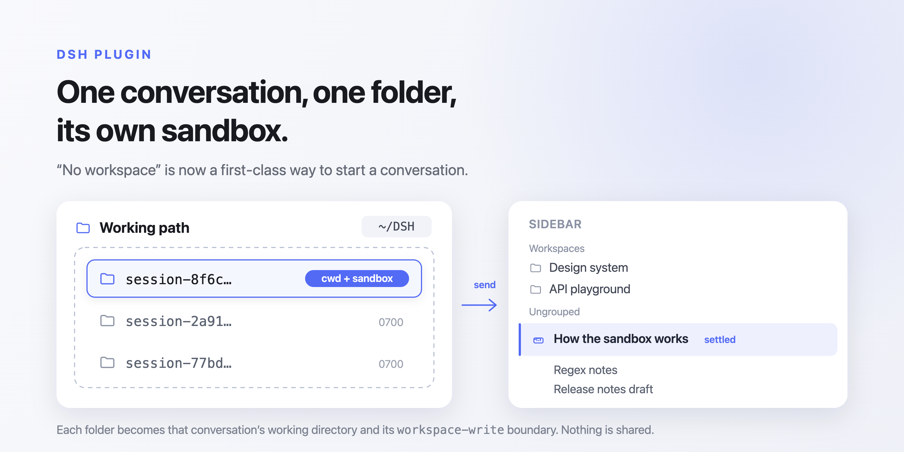
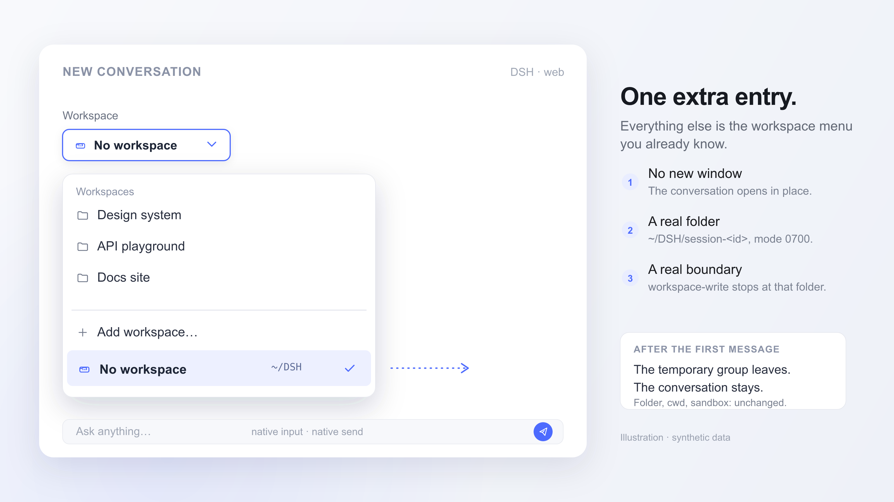
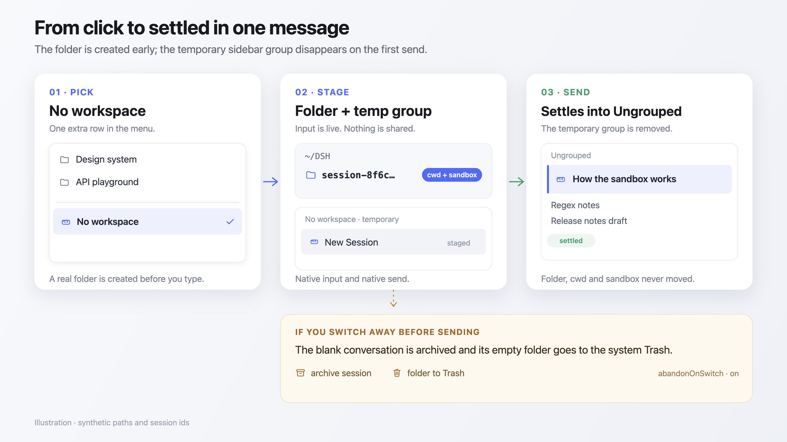
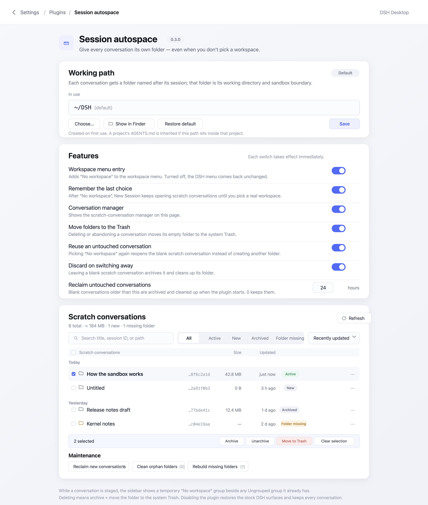
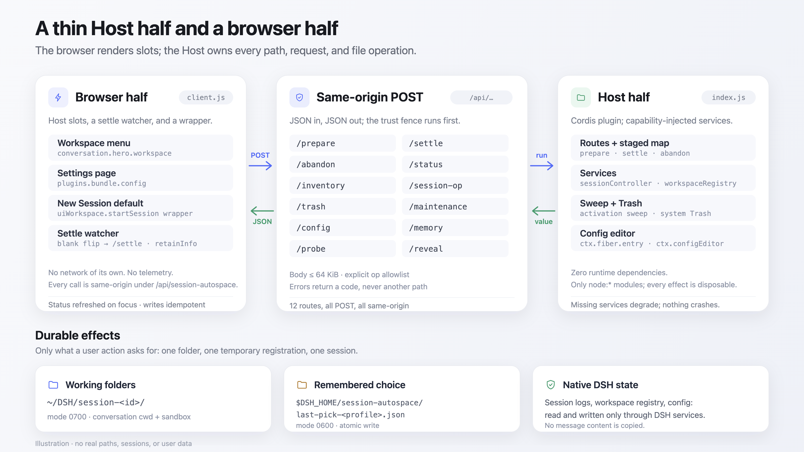

<div align="center">
  
</div>

# 会话自动空间 · Session Autospace

> 不指定工作区，也能开始一次真正的对话。

[中文](README.md) · [English](README.en.md)

[](LICENSE)
[](package.json)
[](package.json)
[](test)

**Session Autospace** 是 DSH 的一个组合包插件。它在新建对话页的工作区菜单里加入一项「不指定工作区」：点下去，插件为这次对话创建 `<工作路径>/session-<uuid>/`，把这个文件夹作为会话的 `cwd` 与 `workspace-write` 沙盒边界。输入、发送、标题、归档仍然走 DSH 原生路径；第一条消息发出后，临时工作区自动撤销，对话安静地落进侧栏的「未分组」。

它不新增模型工具，不代理消息，不修改 DSH 的既有配置或会话日志（设置页只写本插件自己的行配置），也不要求你把工作路径设成某个项目。

---

## 为什么需要它

DSH 的工作区模型是项目中心的：一个工作区对应一个真实目录，新对话从工作区开始，沙盒写入被限制在该目录内。这对项目开发很合适，但对另一类对话很别扭：

> 「帮我看一下这段日志」「把这个正则解释清楚」「写一个一次性脚本」「先随便记几笔，稍后再归档」

这些对话不属于任何项目。以前只有两个选择：

1. 塞进最近的工作区。临时文件、脚本和实验结果污染项目目录。
2. 开一个临时工作区。多个对话共享同一个 `cwd`，彼此可以覆盖对方的文件，沙盒边界也混在一起。

Session Autospace 增加第三种选择：**一次对话，一个文件夹，一条沙盒边界**。对话的沙盒写入边界互不重叠，归档或删除时也容易收拾。

## 它做了什么

- **工作区菜单多一项「不指定工作区」**。其余工作区行、「添加工作区…」和键盘操作保持不变；关掉开关，DSH 原菜单原样回来。
- **真实会话、真实目录**。插件铸造 `session-<uuid>`，创建同名目录（`0700`），登记一个临时工作区，再用这个工作区创建空白会话。会话的不可变 `cwd` 就是这个目录。
- **原生输入与发送**。不替换输入区、不拦截消息、不改写会话内容。首条 `turn/start` 后，插件只做一件事：删掉临时工作区登记。
- **落进未分组**。临时分组消失，对话成为普通会话，文件夹、`cwd`、沙盒边界都不变。
- **记住上次选择**。选过「不指定工作区」后，侧栏、标题栏和 `⌘N` 的「新建会话」会继续开一个临时会话；选一次普通工作区就恢复。当前对话属于普通工作区时，新建仍留在该工作区。
- **一个设置页**。工作路径、九项设置、临时会话管理区都在「设置 → 插件 → 会话自动空间」。
- **会话管理**。搜索、筛选、排序、打开、重命名、置顶、归档、在访达中显示、复制路径、移入废纸篓，以及批量操作和维护动作。
- **安全删除**。DSH 没有永久删除：删除的含义是「归档会话 + 把文件夹移入系统废纸篓」。运行中的会话会先被拒绝，确认后才停止并归档。
- **双语、键盘与可访问性**。跟随 DSH 语言（`zh` / `en`），菜单、行菜单、对话框都有键盘路径和焦点还原。

## 界面

> 下面的配图是按实际界面比例绘制的示意图，使用合成路径和会话标题，不包含任何真实用户数据。源文件在 `docs/images/`，可以按需替换。

### 新对话页：多一行「不指定工作区」



菜单仍然是 DSH 的工作区菜单：上面是已有工作区，分隔线下面是「添加工作区…」和「不指定工作区」。入口行右侧显示新文件夹会落在哪里（默认 `~/DSH`）。

### 三个状态：选择、暂存、落定



- **选择**：创建 `session-<uuid>` 目录、临时工作区和空白会话。
- **暂存**：输入区可用，侧栏顶部出现临时的「不指定工作区」分组；如果原本已有「未分组」，两组并存。
- **落定**：首条消息发出，临时分组消失，对话进入「未分组」，与普通未分组对话显示一致。
- **放弃**：发送前切到别的会话，空白会话被归档，空文件夹进入系统废纸篓（可用 `abandonOnSwitch` 关闭）。

### 设置页：路径、开关、临时会话管理

[](docs/images/settings.png)

<sub>点击图片查看原图。</sub>

工作路径卡支持输入绝对路径、选择目录、在访达中显示、恢复默认；功能卡里每个开关即时生效；管理区把会话列表、文件夹事实和维护动作放在一页。

## 安装

### 环境

- DSH `>=0.2.1-rc.2 <1.0.0`（见 `package.json` 的 `engines.dsh`）。
- 可用的 `dsh` CLI。
- 可访问 GitHub，以及本机可用的 `git`（pnpm 解析 GitHub 依赖时需要）。
- macOS、Linux 或 Windows。文件夹回收依赖系统废纸篓；不可用时界面会引导「在访达中显示」，不会退化成硬删除。

### 从 GitHub 安装（推荐）

```sh
dsh plugin --profile <profile> add github:DaozeTang/dsh-session-autospace
```

`dsh plugin add` 会把参数转交给 profile 目录下的 pnpm，由 pnpm 直接从 GitHub 拉取仓库；**不需要 `git clone`，也不需要在本地保留源码或提前构建**。`<profile>` 是你要安装到的 profile 名，例如 Desktop 常用的 `desktop`。不确定时先看 profile 列表：

```sh
ls "${DSH_HOME:-$HOME/.dsh}/profiles"
```

安装后重启 DSH，或重新打开窗口。验证这一层是否进入组合：

```sh
dsh --profile <profile> --dump-config | grep -n "session-autospace"
```

应该能看到 `session-autospace` 的 layer 或行。插件提供的是普通 JavaScript，没有构建步骤，从 GitHub 安装同样不需要额外编译。

需要指定分支、tag 或提交时，把引用加在仓库地址后面：

```sh
dsh plugin --profile <profile> add github:DaozeTang/dsh-session-autospace#main
```

把 `main` 换成 tag 或提交哈希即可锁定到具体版本。

### 从本地目录安装（开发用）

```sh
git clone https://github.com/DaozeTang/dsh-session-autospace.git
dsh plugin --profile <profile> add ./dsh-session-autospace
```

适合改完源码后立刻试用；日常安装用上面的 GitHub 命令即可。

### 从 tarball 安装

```sh
pnpm pack
dsh plugin --profile <profile> add ./dsh-session-autospace-0.3.0.tgz
```

### 升级与移除

```sh
# 升级：先移除，再重新从 GitHub 添加
dsh plugin --profile <profile> remove dsh-session-autospace
dsh plugin --profile <profile> add github:DaozeTang/dsh-session-autospace
```

带 `#` 的安装按指定的分支、tag 或提交解析；换版本时修改 `#` 后面的引用即可。

移除插件不会删除已经创建的会话或文件夹；它们仍是普通 DSH 会话。需要清理时见[卸载](#卸载)。

## 快速开始

1. 新建对话，打开工作区菜单。
2. 选择「不指定工作区」。页面进入可输入状态，chip 显示「不指定工作区」。
3. 输入并发送第一条消息。
4. 侧栏的临时分组消失；对话出现在「未分组」，与普通对话显示一致。
5. 再点「新建会话」：仍然进入一个新的临时会话。打开一个普通工作区对话后，新建会回到该工作区。

对应的目录结构：

```text
~/DSH/
  session-8f6c2a1d-.../      # 这次对话的 cwd 与 sandbox 边界
  session-2a91f0b3-.../
  session-77bde41c-.../
```

## 工作方式

### 三个状态

| 状态 | 会话 | 工作区登记 | 侧栏 | 输入区 | 沙盒边界 |
| --- | --- | --- | --- | --- | --- |
| 空闲 | 无 | 无 | 不变 | — | — |
| 暂存 | 已创建、空白、无消息 | 一条临时登记，标题为「不指定工作区」 | 顶部临时分组，内含 New Session | DSH 原生，可输入 | `<工作路径>/session-<uuid>` |
| 落定 | 同一个会话，已有首轮 | 已撤销 | 「未分组」里的普通行 | DSH 原生 | 同一文件夹，未改变 |
| 放弃 | 空白会话被归档 | 已撤销 | 分组和 New Session 消失 | — | 空文件夹进入废纸篓（可关闭） |

状态机：

```text
idle --prepare--> preparing --ok--> staged
preparing --fail--> idle（错误留在菜单里，可重试）
staged --turn/start--> settling --> settled（删除临时登记）
staged --主视图被其它会话占据且仍空白--> abandoning --> abandoned（撤登记 + 归档 + 回收空目录）
staged --改选真实工作区--> abandoning
staged --超过回收阈值--> reclaiming --> reclaimed
```

### 为什么文件夹在点击时就创建

DSH 的可输入空白会话必须挂在真实工作区下，而工作区路径必须是已存在的目录；会话的 `cwd` 创建后不可改。因此插件在点击「不指定工作区」时就把目录和会话建好，而不是等到发送。代价是暂存期间侧栏会多一个临时分组；发送或放弃后立即消失。

### 收尾有三条通道

1. **宿主事件**：`session/event` 捕获该会话的第一个 `turn/start`，异步删除临时工作区登记。
2. **客户端观测**：客户端用 `useSessions` 观察空白状态由真变假，调用幂等的 `/settle`。
3. **激活清扫**：插件启动时重建暂存表，处理崩溃、关窗口或长时间不用留下的残留；超过 `autoReclaimHours` 的空白会话会被回收。

宿主收尾失败会退避重试（200 / 800 / 2000ms，最多 3 次），之后留给下次激活清扫；用户全程无感。

### 内部结构



浏览器半只渲染宿主槽位（工作区菜单和设置页），并包装 `uiWorkspace.startSession`。它不直接碰文件系统，也不发远程请求。

宿主半是单文件 Cordis 插件，按 `config`、`paths`、`scratch`、`settle`、`trash`、`inventory`、`routes`、`sweep`、`log` 组织，零运行时依赖，只使用 `node:*`。所有注册都由 `ctx.effect` / `ctx.inject` 持有；缺服务时关闭对应能力，而不是崩溃。

### 「新建会话」怎么记住上次选择

DSH 没有为新会话入口提供插槽，侧栏按钮、标题栏按钮和 `session.new` 命令最终都调用 `uiWorkspace.startSession`。插件在客户端包装这个方法，只接管「没有显式工作区、也没有初始内容参数」的调用：

- 显式指定普通工作区 → 交给 DSH 原本的「当前工作区」逻辑。
- 显式指定临时工作区 → 改走 `/prepare`，不把第二个对话放进同一个文件夹。
- 带 `prompt` / `clearPreviousDraft` 的调用 → 原样透传。
- 当前主视图属于普通工作区 → 交给 DSH，不把正在项目里的人拽走。
- 没有工作区且上次选择是 `scratch` → 调用与菜单相同的准备流程。

任何异常都回退到原方法；服务撤销或插件重载时也会还原。选择写入 `$DSH_HOME/session-autospace/last-pick-<profile>.json`，不碰 profile 配置，也不触发插件重启。

## 配置

所有字段都在「设置 → 插件 → 会话自动空间」里；默认值也写在 `cordis.patch.yml`。

| 键 | 界面 | 默认 | 说明 / 关闭后 |
| --- | --- | --- | --- |
| `workspaceRoot` | 工作路径 | `""` | 空值表示 `~/DSH`；保存时校验绝对路径、NUL 和可写性 |
| `pickerEntry` | 工作区菜单入口 | `true` | 关闭即注销菜单槽位，DSH 内置菜单回来 |
| `rememberPick` | 记住上次选择 | `true` | 关闭后「新建会话」回到 DSH 的「当前工作区，否则最近工作区」 |
| `management` | 会话管理区 | `true` | 关闭后整张管理卡不渲染 |
| `trashOnDelete` | 删除时回收文件夹 | `true` | 关闭后删除只归档，文件夹保留 |
| `reuseBlank` | 复用未开始的会话 | `true` | 关闭后每次点击都新建文件夹 |
| `abandonOnSwitch` | 切换走时自动消失 | `true` | 关闭后只撤登记，保留会话和目录 |
| `autoReclaimHours` | 自动回收未开始的会话 | `24` | `0` 表示不自动回收；范围 0–8760 小时 |

如果工作路径位于一个含 `.git` 的项目树内，项目根到 `.git` 之间的 `AGENTS.md` 会作用于在此创建的每个对话；设置页会在路径卡片里提示。

默认 patch：

```yaml
- insert:
    - id: session-autospace
      name: dsh-session-autospace
      config:
        workspaceRoot: ''
        pickerEntry: true
        rememberPick: true
        management: true
        trashOnDelete: true
        reuseBlank: true
        abandonOnSwitch: true
        autoReclaimHours: 24
```

配置写入走宿主的 `configEditor`，保存后插件会按 Loader 生命周期重建一次；客户端在写操作后重新拉取状态。不写 schema，也不依赖 `@deepseek-ai/schemastery`。

## 会话管理

「设置 → 插件 → 会话自动空间」的第三张卡片把客户端会话列表和宿主文件夹清单按 session id 合并：

| 动作 | 行为 |
| --- | --- |
| 打开会话 | 切到该对话 |
| 重命名 | 只改标题，不碰目录 |
| 置顶 / 取消置顶 | 调用 DSH 的 pin 能力 |
| 归档 / 取消归档 | 归档可恢复；运行中的会话需先确认停止 |
| 在访达中显示 | 通过宿主的 reveal 能力打开文件夹 |
| 复制路径 | 复制文件夹绝对路径 |
| 移入废纸篓 | 先归档，再把文件夹移到系统废纸篓；不硬删除 |
| 批量操作 | 归档、取消归档、移入废纸篓，单次最多 100 条 |
| 清理未开始 | 归档超过阈值的空白会话并清理空目录 |
| 清理孤立文件夹 | 形如 `session-<uuid>` 但没有会话认领的目录 |
| 重建缺失文件夹 | 会话还在、目录被删时重新创建 |

搜索覆盖标题、session ID 和路径；筛选有全部 / 进行中 / 未开始 / 已归档 / 文件夹缺失；排序有最近更新、标题、占用空间。列表高度随会话数量自适应，最多约 10 行（`min(52vh, 420px)`）；超出后列表在卡片内滚动，列头固定在顶部，下方的维护与状态区不必再等列表走完。不可逆动作会先弹确认框，正文写明「归档可恢复，文件夹进废纸篓」。

## 数据与隐私

### 插件写什么

```text
<工作路径>/
  session-<uuid>/                 # 会话的 cwd 与沙盒边界；创建时 mode 0700
    …（DSH 工具在此读写）

$DSH_HOME/session-autospace/
  last-pick-<profile>.json        # 上一次新对话的选择；mode 0600，原子写
```

- 目录名严格等于会话 id，匹配 `^session-[0-9a-f]{8}-[0-9a-f]{4}-[0-9a-f]{4}-[0-9a-f]{4}-[0-9a-f]{12}$`。
- 会话日志不在这个目录里，仍由 DSH 放在自己的 `$DSH_HOME/sessions/...` 下；插件不读取消息内容。
- 记忆文件只保存 `{version, kind, at}`，不保存标题、路径或对话内容。
- 目录权限 `0700`、记忆文件 `0600` 是尽力而为；权限设置失败不会阻断主流程。

### 本地优先

- 插件**不发起任何远程请求**，没有遥测、统计或分析。
- 没有远程字体、远程图标或 CDN 依赖；界面只使用宿主的设计令牌和本地资源。
- 与浏览器的通信只有同源的 `POST /api/session-autospace/*`。
- 不新增模型工具，不读取或转发消息；模型看到的内容与普通 DSH 会话一致。

### 仓库里的隐私约定

- 所有示例路径统一使用 `~/DSH` 或 `/Users/example`，不包含真实用户名。
- 文档配图由 `docs/images/*.svg` 渲染，使用合成标题、路径和 session id。
- 测试夹具（`test/render-check.mjs`）同样使用匿名路径和固定假 id。
- 提交截图前请确认：没有真实会话标题、真实工作区路径、真实 session id、终端历史或通知内容。

### 安全校验（宿主侧）

- 工作路径：绝对路径、无 NUL、`mkdir -p` 后 `realpath` 稳定。
- 目标目录：位于 `realpath(root)` 之下、基名等于 session id、`lstat` 为目录、拒绝符号链接。
- 会话：必须存在，且 `header.cwd` 与目标目录的 `realpath` 一致；删除场景拒绝运行中的会话。
- 请求：`POST` JSON，body ≤ 64 KiB，先过同源 admission fence；操作走白名单，标题 ≤ 200 字符，批量 ≤ 100 条。
- 错误只回显相对信息，不回显其他路径。
- 废纸篓不可用时返回明确错误，界面引导手动处理，绝不降级为硬删除。

### 回收规则

只有「目录为空」且「对应会话仍空白」时，自动回收才会把目录移入废纸篓。目录里有任何内容时只归档，由用户显式删除。这个规则保证插件不会悄悄丢掉用户文件。

## HTTP 契约

浏览器半和宿主半通过同源 POST 通信。所有路由返回 `{ ok: true, value }` 或 `{ ok: false, code, message }`。

<details>
<summary>展开 12 条路由（贡献者参考）</summary>

| 路由 | 请求 | 成功返回 |
| --- | --- | --- |
| `/status` | – | `{root, config, caps, staged, lastPick, version, …}` |
| `/config` | `{patch}` | `{config}` |
| `/memory` | `{kind: 'scratch' 或 'workspace'}` | `{kind, at}` |
| `/prepare` | `{requestId, locale}` | `{sessionId, workspaceId, path, reused}` |
| `/settle` | `{sessionId}` | `{settled, noop?}` |
| `/abandon` | `{sessionId, trash?}` | `{abandoned, trashed?, trashError?, settled?}` |
| `/inventory` | `{fresh?}` | `{root, folders, orphans}` |
| `/session-op` | `{sessionId, op, title?}` | `{ok}` |
| `/probe` | `{path}` | `{path, exists, writable, projectRoot}` |
| `/trash` | `{sessionId}` | `{archived, trashed, kept?, method?, trashError?, path?}` |
| `/reveal` | `{sessionId? 或 path?}` | `{revealed}` |
| `/maintenance` | `{op, ids?}` | `{changed, skipped}` |

常见错误码：`ROOT_INVALID`、`ROOT_UNWRITABLE`、`SESSION_CONFLICT`、`WORKSPACE_CREATE_FAILED`、`NOT_SCRATCH`、`SETTLE_FAILED`、`ARCHIVE_FAILED`、`SESSION_RUNNING`、`FOLDER_MISSING`、`OUT_OF_ROOT`、`SYMLINK_REJECTED`、`TRASH_UNAVAILABLE`、`CONFIG_INVALID`、`CONFIG_WRITE_FAILED`、`BODY_TOO_LARGE`。

</details>

## 兼容性与降级

插件不设精确版本门禁，也不把 `@deepseek-ai/*` 写进 `peerDependencies`；运行时按能力探测，缺失能力时关闭对应功能而不是崩溃。

| 缺失的能力 | 行为 |
| --- | --- |
| `webServer` 或 `connection` | 路由不注册，菜单入口行置灰并说明原因 |
| `configEditor` | 设置页只读，开关置灰并说明原因 |
| 系统废纸篓不可用 | 删除动作置灰，保留归档，引导「在访达中显示」 |
| `session/event` | 只靠客户端 blank 观测和激活清扫 |
| `retainInfo` | 关闭「切换走自动消失」，改用激活清扫 |
| `uiWorkspace` 或 `startSession` 形状变化 | 不安装包装，「新建会话」保持 DSH 原行为；菜单、设置页不受影响 |
| 记忆文件不可读 / 不可写 | 读取失败视为没有记忆；写入失败只记日志，本次页面内仍按新选择生效 |
| 宿主槽位契约变化 | 不渲染并记一次日志，内置菜单不受影响 |

## 已知限制

- **暂存期多一个分组**。DSH 的侧栏没有「置顶且不属于任何分组」的位置，而可输入的空白会话必须挂在真实工作区下。发送或切走后分组立即消失。
- **文件夹在点击时创建**，不能推迟到发送：可输入空白会话必须挂在真实工作区下，工作区路径必须已存在，会话 `cwd` 创建后不可改。
- **删除只有组合语义**：DSH 没有永久删除 API，所以删除 = 归档 + 把文件夹移入系统废纸篓。
- **替换菜单依赖宿主契约**：`conversation.hero.workspace` 的 owner props 变化时，插件会退化为不渲染并记日志，而不是崩溃。
- **记忆按 profile 保存**，不跨机器同步；`DSH_HOME` 未设置时退回 `~/.dsh`。
- **「记住上次选择」依赖 `uiWorkspace.startSession` 仍是普通实例方法**。方法消失、改名或对象不可扩展时，只会回到 DSH 原行为，不影响菜单和设置页。

## 开发

### 目录

设计边界和关键取舍见 [docs/DESIGN.md](docs/DESIGN.md)。

```text
dsh-session-autospace/
├── index.js              # 宿主半：路由、暂存表、清扫、废纸篓
├── client.js             # 浏览器半：菜单、设置页、startSession 包装
├── cordis.patch.yml      # 默认配置行
├── package.json          # dsh.bundle + dsh.client 清单
├── locale/               # 插件详情页的中英文元数据
├── icon.svg
├── docs/
│   ├── DESIGN.md         # 设计边界与关键取舍
│   ├── DETAIL.md         # 插件详情页配图
│   ├── DETAIL.zh.md
│   ├── preview.svg
│   └── images/           # README 配图（SVG 源 + PNG 渲染）
└── test/
    ├── host-check.mjs    # 假服务 + 真实文件系统的宿主冒烟测试
    └── render-check.mjs  # 桩 React 的客户端渲染测试
```

### 测试

```sh
npm test
# 或分开跑
npm run test:host
npm run test:render
```

- `test/host-check.mjs` 用假 Cordis 服务驱动真实路由和真实文件系统，覆盖配置归一化、prepare 幂等与复用、settle、abandon、session-op、trash、inventory、probe、maintenance、信任围栏、激活清扫和记忆文件重启读回等 23 个场景。
- `test/render-check.mjs` 把 `client.js` 载入桩 React，递归渲染菜单、设置页、行菜单、对话框等全部表面，检查元素树与 hook 形状；它不替代在真实 GUI 里看一眼。

### 贡献

1. Fork 并开分支。
2. 改动宿主逻辑时补 `test/host-check.mjs` 场景；改动客户端表面时补 `test/render-check.mjs` 夹具。
3. 同时更新 `client.js` 里的 `EN` / `ZH` 字典和 `locale/*.json` 元数据。
4. 保持零运行时依赖；只使用 `node:*` 模块。
5. **不要在代码、夹具、文档或截图中提交真实个人信息**：真实用户名、真实路径、真实会话标题、真实 session id、token、终端历史都不行。示例统一用 `/Users/example` 或 `~/DSH`。
6. 提交前跑 `npm test`。

## 卸载

```sh
dsh plugin --profile <profile> remove dsh-session-autospace
```

- 移除插件后，菜单、设置页和「新建会话」行为都会复原；已经创建的会话仍是普通 DSH 会话，文件夹也保留。
- 想彻底清理，先归档或删除不再需要的临时会话，再删除 `<工作路径>/session-*` 中确认无用的目录。
- 可选的记忆文件：`$DSH_HOME/session-autospace/last-pick-<profile>.json`。
- 不要直接删除仍有会话引用的目录：会话会显示为「文件夹缺失」，但不会丢消息；可以在管理区重建目录，或保留作历史记录。

## License

[MIT](LICENSE) © dsh-session-autospace contributors

---

如果这个插件帮你把「临时聊两句」从项目目录里分了出去，欢迎在仓库里留一个 star，或者提一个 issue 讲讲你的工作流。
